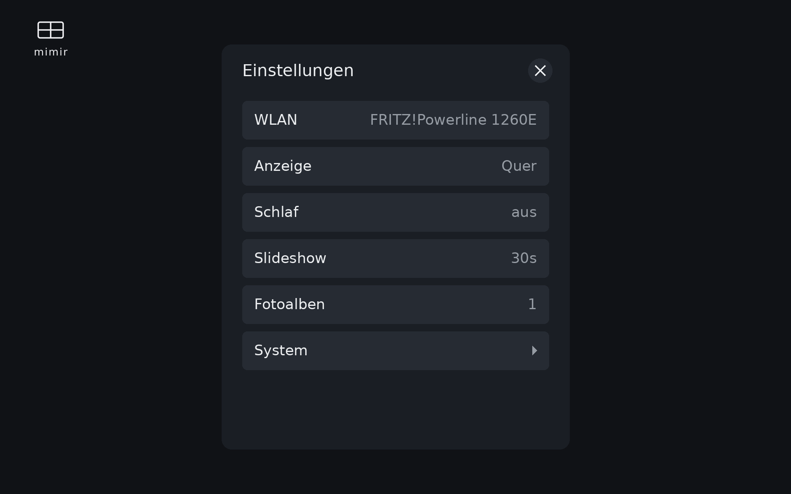
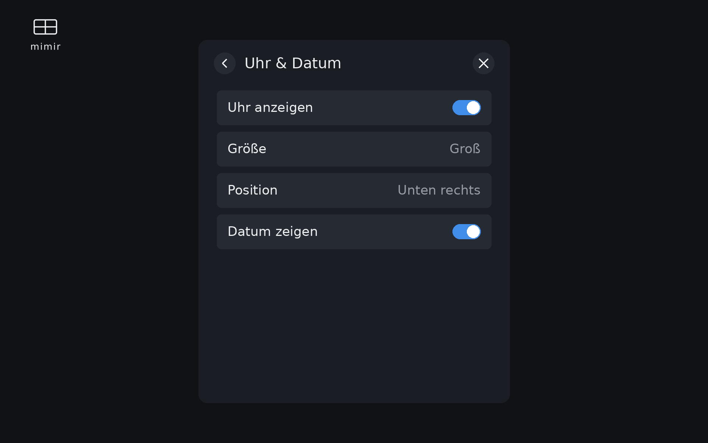
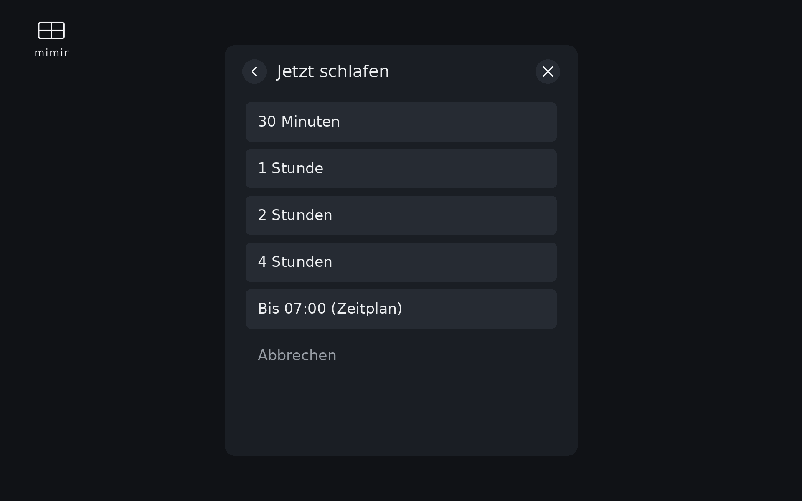
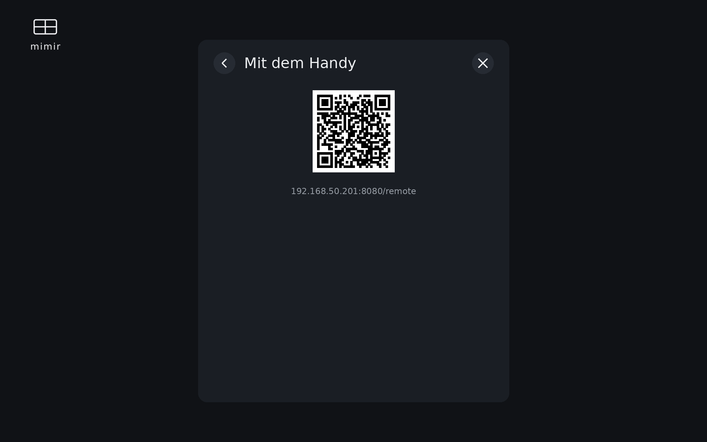

<div align="center">

# 🖼️ mimir

**A self-contained digital photo frame for the Raspberry Pi Zero 2 W.**

Pull photos straight from Synology Photos, Google Photos and Immich, process them
on-device, and show them full-screen with smooth fades — no NAS, no cloud
middleman, no browser.

[](LICENSE)
[](https://www.raspberrypi.com/)
[](#option-a--flash-the-ready-made-image-recommended)

</div>

---

## Why mimir?

Most "smart" frames want a subscription and route your family photos through
someone else's cloud. mimir doesn't. Each frame is a tiny appliance that talks
**directly** to your own photo albums, keeps a local copy, and renders it itself.
Flash the image, point it at a shared album, hang it on the wall.

- 🔌 **Self-contained** — all syncing and image processing happens on the Pi. No NAS plugin, no server, no account.
- 🖥️ **Native renderer** — photos *and* videos play through a direct GStreamer/DRM pipeline (`frame.slideshow`). No Chromium — which the Zero 2 W can't drive anyway — so it stays light and seamless, even for looping video.
- 👆 **On-device settings** — a full touch menu drawn straight to the framebuffer. No app, no second screen needed.
- 📱 **Phone remote** — scan a QR code to manage albums and trigger a sync from your phone.
- 🌙 **Smart sleep** — scheduled quiet hours plus a one-tap "sleep for N hours" timer that always wakes itself.
- 🔁 **Hands-off** — auto-updates on boot, re-syncs during sleep, and self-heals the display and touch input.

## Screenshots

The entire settings UI is rendered natively on the frame — open it any time by
**holding the top-right corner for ~1.5 s**.

| Settings menu | Clock & date overlay |
|:---:|:---:|
|  |  |
| **Sleep timer** | **Phone remote (QR)** |
|  |  |

Each menu row shows its current state inline (Wi-Fi, orientation, sleep window,
interval, album count), so the whole frame reads at a glance.

## How it works

```
Photo sources
  ├── Synology Photos  (share links, direct or via Tailscale)
  ├── Google Photos    (public shared-album URLs)
  └── Immich           (share links)
        │
        ▼
Raspberry Pi Zero 2 W
  ├── frame.sync      ── downloads new photos/videos, drops deleted ones,
  │                      processes to the active orientation (blur-fill backgrounds),
  │                      transcodes videos during sleep so live playback stays smooth
  ├── frame.server    ── HTTP :8080 — phone remote, setup wizard, sleep/sync API,
  │                      WiFi-hotspot fallback with captive portal
  └── frame.slideshow ── owns the display directly (DRM/kmssink + framebuffer):
                         full-screen photos with fade transitions, gapless video
                         loops, and the native touch settings menu
```

## Features

**Photos & sources**
- **Multi-source sync** — Synology Photos, Google Photos and Immich shared albums, all at once.
- **Smart fill** — matching-orientation shots crop to fill; the rest get a blurred, dimmed fill background instead of black bars.
- **HEIC support** — iPhone photos handled natively via `pillow-heif`.
- **Video support** — clips are transcoded on-device and looped seamlessly alongside photos.
- **Stale cleanup** — anything removed from the source album is deleted locally too.
- **Single-orientation library** — keeps the full library only for the active orientation; the other side holds a few shipped sample defaults, so the SD card isn't wasted on photos you can't see. Rotating re-syncs the new orientation automatically.

**Display & interaction**
- **Native slideshow** — direct hardware video decode and rendering; no browser.
- **On-device touch UI** — WiFi, display, orientation, sleep, slideshow, albums, system info and power, all drawn to the framebuffer.
- **Clock & date overlay** — optional, with size and corner position, drawn over the slideshow.
- **Phone remote** (`/remote`) — add/remove albums and run "Sync Now" from a QR code.
- **Auto resolution detection** — reads the panel size from the framebuffer.
- **Bilingual** — English and German (i18n).

**Operation**
- **Sleep schedule** — per-weekday quiet hours that stop the slideshow (frees RAM) and switch off the backlight.
- **Sleep timer** — "Jetzt schlafen" picks a duration (30 min / 1 / 2 / 4 h, or until the next scheduled wake) and the frame reliably wakes itself — no dependence on a wake tap.
- **Configurable backlight control** — DDC/CI, DPMS, brightness, or black-only fallback, with verify-and-retry so it actually goes dark on flaky panels.
- **WiFi hotspot fallback** — brings up a `mimir-Setup` hotspot with a captive portal when there's no known network.
- **Auto-update on boot** — pulls the latest code before starting.
- **First-time setup wizard** — language, orientation, frame settings, sleep test, albums, done.

## Requirements

### Hardware
- Raspberry Pi Zero 2 W (or any newer Pi).
- Display with HDMI input (tested: ANMITE 14" 1920×1200 touchscreen).
- Optional but recommended: a USB touchscreen for the on-device menu.

### Software
- Raspberry Pi OS Trixie (Debian 13), 64-bit.
- Python 3.11+.
- GStreamer + `python3-gi` for the native slideshow/video pipeline.
- `ddcutil` for backlight control; Tailscale (optional) for Synology access over VPN.

*(All of this is pre-baked into the ready-made image — see Option A.)*

## Setup

Flashing the ready-made image (**Option A**) is the easiest path. Use Option B/C
only if you want to build from source.

> 🇩🇪 Eine deutsche Kurzanleitung gibt es in [ANLEITUNG.md](ANLEITUNG.md).

### Option A — Flash the ready-made image (recommended)

1. Download the latest `mimir-*.img.xz` from the
   [Releases page](https://github.com/rwkaspar/mimir/releases).
2. Flash it with [Raspberry Pi Imager](https://www.raspberrypi.com/software/):
   *Choose OS → Use custom* → pick the `.img.xz`. In the customization dialog
   set your **WiFi**, **locale/timezone**, and enable **SSH** if you want
   remote access — these still apply on top of the image.
3. Insert the card and power on. The first boot provisions itself (a few
   minutes) and then shows the setup wizard.
4. Configure your photo albums via the on-screen wizard — or, if no network
   was set, connect to the **`mimir-Setup`** WiFi hotspot it creates and
   follow the captive portal.

- **Target:** 64-bit (arm64), **Raspberry Pi Zero 2 W or newer**.
- **Login:** user `frame`, password `photoframe` — change it after first login
  (`passwd`). If SSH is enabled, reach it at `mimir.local`.

### Option B — Prepare an SD card from source

Works on **Windows**, **macOS**, and **Linux** — no ext4 access needed.

1. **Flash** Raspberry Pi OS with [Pi Imager](https://www.raspberrypi.com/software/):
   - User: `frame_user` (set a password you'll remember)
   - SSH: enabled
   - WiFi: enter your network (or skip — the frame creates a setup hotspot)

2. **Re-insert** the SD card so the boot partition (FAT32) mounts.

3. **Run the prepare script:**

   **Windows** (no git required):
   1. Download [`prepare_sd.bat`](https://raw.githubusercontent.com/rwkaspar/mimir/main/scripts/prepare_sd.bat) (right-click → Save as)
   2. Open a terminal where you saved the file
   3. Run:
      ```cmd
      prepare_sd.bat F:
      ```
      Replace `F:` with the drive letter of the boot partition.
      The script downloads everything from GitHub automatically.

   **Linux / macOS:**
   ```bash
   git clone https://github.com/rwkaspar/mimir.git digital_photo_frame
   cd digital_photo_frame
   bash scripts/prepare_sd.sh
   ```
   The script auto-detects the boot partition. Pass the path manually if needed:
   ```bash
   bash scripts/prepare_sd.sh /media/$USER/bootfs
   ```

4. **Eject** the SD card and insert it into the Pi.

5. **Wait for 3 boots** (~10 minutes total):
   - **Boot 1:** Pi Imager settings apply (user, WiFi, SSH), then the bootstrap script copies the repo to the home directory and reboots.
   - **Boot 2:** Full setup runs (packages, Python venv, systemd services) and reboots.
   - **Boot 3:** The photo frame starts — the setup wizard appears on screen.

6. **Monitor progress** (optional):
   ```bash
   ssh frame_user@<pi-ip> journalctl -fu photo-frame-firstboot
   ```

### Option C — Manual setup on the Pi

```bash
git clone https://github.com/rwkaspar/mimir.git digital_photo_frame
cd digital_photo_frame
sudo bash scripts/setup_pi.sh
```

### Updating an existing frame

```bash
bash ~/digital_photo_frame/scripts/deploy_update.sh
```

> The frame also runs `git reset --hard origin/main` on boot, so pushing to
> `main` is enough to deploy — a hand-copied file on the Pi gets overwritten.

## Configuration

Edit `config_frame.yaml`, or configure via the setup wizard / phone remote:

```yaml
setup_complete: false  # Set to true after the wizard completes

frame:
  name: "living-room"
  orientation: "horizontal"  # or "vertical"

synology:
  share_urls:
    - "https://100.101.43.67:5443/mo/sharing/AbCdEfG"  # Tailscale IP works directly
  share_passphrases:
    - "your-passphrase"

google_photos:
  share_urls:
    - "https://photos.app.goo.gl/yourAlbumLink"

immich:
  share_urls: []
  share_passphrases: []

photos:
  base_dir: "/srv/frame/photos"
  quality: 85
  blur_radius: 40
  blur_darken: 0.6
  horizontal: { width: 1920, height: 1200 }
  vertical:   { width: 1200, height: 1920 }

slideshow:
  interval: 10
  fade_duration: 1.0

energy_save:
  method: "ddcci"  # ddcci | dpms | brightness | black_only
```

### Services

```bash
sudo systemctl enable --now photo_frame_server photo_frame_slideshow
```

- `photo_frame_server` — the HTTP API, remote UI and setup wizard (`:8080`).
- `photo_frame_slideshow` — the native renderer that owns the display.

Sync runs on demand ("Sync Now" in the menu or phone remote) and automatically
during sleep, when more RAM and CPU are free.

## The phone remote (`/remote`)

Open **Settings → Fotoalben → QR** and scan the code:

- **Synology Photos** — add/remove albums with share URL + passphrase.
- **Google Photos** — add/remove shared-album URLs (no auth needed).
- **Immich** — add/remove shared-album links.
- Album names are resolved and listed alphabetically.
- Changes persist to `config_frame.yaml`; **Sync Now** runs an immediate sync.

## Sleep mode

Sleep stops the slideshow (freeing RAM) and blanks the panel:

1. Stops `photo_frame_slideshow` and fills the framebuffer black (HDMI stays
   active — no blue "no signal" screen).
2. Switches off the backlight via the configured method, with verify + retry:
   - `ddcci` — DDC/CI power standby (`ddcutil setvcp d6 4/1`)
   - `dpms` — Wayland DPMS (`wlopm --off/--on`)
   - `brightness` — DDC/CI brightness to 0 (`ddcutil setvcp 10 0/100`)
   - `black_only` — framebuffer only, no backlight control (fallback)
3. Runs a photo sync and transcodes any pending videos (idle CPU during sleep).
4. Wakes on schedule, on a sleep-timer expiry, or via the API/Home Assistant —
   and the wake is verified and self-healing, so a panel that drops off the bus
   overnight is brought back automatically rather than staying black.

The setup wizard tests each backlight method so you can pick the one your monitor
actually obeys.

## Project structure

```
digital_photo_frame/
├── frame/                      # Python package
│   ├── server.py               # HTTP server + handler factory
│   ├── routes.py               # All HTTP endpoints
│   ├── config.py               # AppState (config + shared state)
│   ├── slideshow.py            # Native renderer (DRM/kmssink + framebuffer)
│   ├── native_ui.py            # On-device touch settings menu
│   ├── native_video.py         # Seamless GStreamer video loop
│   ├── video.py                # Video transcode / rotation pipeline
│   ├── energy.py               # Sleep schedule, sleep timer, backlight, wake-heal
│   ├── sync.py                 # Multi-source sync engine (single-orientation model)
│   ├── processing.py           # Blur-fill photo processing
│   ├── database.py             # SQLite photo-state DB
│   ├── wifi.py                 # WiFi hotspot fallback
│   ├── mqtt_client.py          # Home Assistant / MQTT control
│   └── clients/                # synology.py · google_photos.py · immich.py
├── viewer/
│   ├── remote.html             # Phone remote config UI
│   ├── setup.html              # WiFi captive-portal page
│   └── wizard.html             # First-time setup wizard
├── systemd/                    # Unit files (server, slideshow, update, …)
├── scripts/                    # prepare_sd.* · setup_pi.sh · deploy_update.sh · update.sh
├── docs/                       # screenshots, monetization notes
└── config_frame.yaml           # Per-frame configuration
```

## Boot flow

```
network-online.target
  → photo_frame_update.service    (git pull + pip install, fail-ok)
    → photo_frame_server.service  (frame.server, HTTP :8080)
        IF no WiFi            → hotspot "mimir-Setup" + captive portal
        IF setup_complete=false → setup wizard
    → photo_frame_slideshow.service  (frame.slideshow owns the display)
```

## Troubleshooting

**Sync not working**
```bash
curl http://localhost:8080/sync/status            # status
journalctl -u photo_frame_server -n 50            # logs
curl -X POST http://localhost:8080/sync/trigger   # manual sync
```

**Blue "no signal" during sleep** — try another backlight method:
```bash
sudo ddcutil setvcp d6 4   ;  sudo ddcutil setvcp d6 1    # DDC/CI standby / wake
wlopm --off '*'            ;  wlopm --on '*'               # DPMS
sudo ddcutil setvcp 10 0   ;  sudo ddcutil setvcp 10 80    # brightness
```

**No photos displaying**
```bash
ls /srv/frame/photos/horizontal/ | wc -l
ls /srv/frame/photos/vertical/   | wc -l
grep orientation config_frame.yaml
sudo systemctl restart photo_frame_slideshow
```

## License

mimir is free and open source under the **GNU Affero General Public License v3.0**
(AGPL-3.0) — see [`LICENSE`](LICENSE). You can self-host it freely; if you offer
it to others over a network, you must make your changes available under the same
license.

Contributions are accepted under the [Contributor License Agreement](CLA.md),
which lets the project also offer commercial/OEM licenses in the future. See
[`docs/MONETIZATION.md`](docs/MONETIZATION.md) for the licensing & sustainability
strategy.

## Building the image (maintainers)

A GitHub Actions workflow builds a 64-bit Raspberry Pi OS image with the photo
frame pre-installed, so you can flash it straight from Raspberry Pi Imager
instead of running the SD-prep scripts.

- **Target:** arm64 only, Raspberry Pi Zero 2 W and newer.
- **Build:** push a `vX.Y.Z` tag (the image is attached to the GitHub release),
  or trigger *Build Pi image* manually under the Actions tab.
- **What it bakes:** all apt dependencies pre-installed (so first boot is fast),
  the app on the boot partition, and a first-boot service that runs the normal
  `photo_frame_bootstrap.sh` → `setup_pi.sh` provisioning (venv, services, config).
- **Flashing:** open the `.img.xz` in Raspberry Pi Imager; its WiFi / SSH / locale
  customization still applies. The appliance user is `frame` (password
  `photoframe`). Configure albums via the on-screen wizard / hotspot captive
  portal on first boot.

The build definition lives in `.github/workflows/build-image.yml` and the pi-gen
stage in `imaging/stage-photoframe/`.
